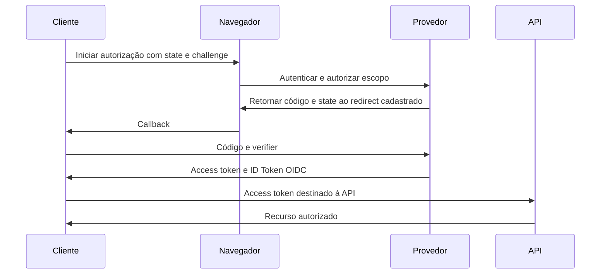

# Aula 020 — OAuth 2.0, OpenID Connect, State e PKCE

**Trilha:** Web/AppSec Fundamentals · **Profundidade:** profunda · **Tempo:** 80–100 min.  
Prática local com Node.js 24. O exercício usa identidades e chaves fictícias; não solicita senha, consentimento ou token de uma conta externa.

## O problema: entrar com um provedor sem entregar sua senha ao aplicativo

Um aplicativo de estudo quer reconhecer Alice e acessar apenas uma API autorizada. Pedir a senha do provedor à própria aplicação mistura responsabilidades e aumenta exposição. Em um fluxo federado, Alice se autentica no provedor; o aplicativo recebe uma resposta verificável, com destino, duração e finalidade definidos.

OAuth é um protocolo de **autorização delegada**: permite ao cliente obter acesso limitado a recursos. OpenID Connect acrescenta a camada de identidade, incluindo ID Token e regras de validação. Obter um access token não é, por si só, uma implementação correta de login OIDC.

Quatro participantes ajudam a separar as decisões:

| Participante | Responsabilidade | No laboratório |
|---|---|---|
| Usuária/agente do usuário | Iniciar o fluxo e interagir com o provedor | Alice é uma identidade fictícia fixa |
| Cliente | Iniciar transação, receber callback e validar resultado | `begin` e `callback` |
| Servidor de autorização/OP | Autorizar, emitir código e tokens | `authorize` e `exchange` |
| Servidor de recursos | Aceitar token destinado à API e aplicar autorização | `apiMe` |

Um **cliente público**, como um aplicativo instalado, não consegue manter um segredo compartilhado escondido em seu código distribuído. Um cliente confidencial pode usar autenticação apropriada no token endpoint. `client_id` identifica o cadastro; não é uma senha. PKCE é relevante para proteger o vínculo da transação, inclusive em clientes que também se autenticam.

## Primeiro, o fluxo legítimo

No Authorization Code Flow com PKCE S256, o cliente cria um `code_verifier` aleatório e deriva seu challenge. Guarda o verifier associado à transação; envia o challenge na autorização. Depois recebe um código curto e o troca por tokens, apresentando o verifier. O servidor verifica se a prova corresponde ao challenge original.



Em um cliente web com backend, a troca costuma ocorrer entre backend e provedor; outros tipos de cliente têm detalhes próprios. O diagrama não significa que seja permitido inserir tokens em URLs arbitrárias ou que todo cliente possa guardar segredo com segurança.

A prática atual recomenda o fluxo de código com proteções adequadas e restringe padrões antigos, como emissão de access token pelo fluxo implícito. Não use grant de senha como atalho para criar um login federado. A recomendação e as condições completas estão na [RFC 9700, OAuth Security BCP](https://www.rfc-editor.org/rfc/rfc9700.html).

## Três vínculos: state, PKCE e nonce

**State** correlaciona a resposta com uma transação iniciada pelo cliente. Deve ser imprevisível, associado à sessão/contexto, validado no retorno e descartado ao concluir. Comparar dois valores ausentes tem a mesma falha estudada em CSRF: ausência não prova correlação.

**PKCE** vincula a troca do código à posse do verifier. Para S256, `challenge = BASE64URL(SHA256(verifier))`, sem padding. Quem vê apenas o challenge não recebe o verifier; um código interceptado não deve bastar para completar a troca. A [RFC 7636](https://www.rfc-editor.org/rfc/rfc7636.html) define geração, transformação e validação. PKCE não valida a assinatura de um ID Token e não escolhe o redirect correto pelo cliente.

**Nonce**, em OIDC, relaciona o ID Token à solicitação de autenticação. Quando enviado, deve ser conferido na resposta relevante. Nosso fluxo sempre emite e exige nonce. Ele não substitui audience, issuer, expiração ou assinatura. Não trate state/nonce/verifier como nomes intercambiáveis para uma única string.

Uma biblioteca pode oferecer defesas protocoladas que mudem quais parâmetros são necessários em determinado perfil. O exercício mantém os três vínculos explícitos para observá-los separadamente; não afirma que todo fluxo OAuth existente obrigatoriamente usa os três.

## Código, access token e ID Token não são a mesma credencial

O **authorization code** é intermediário, curto e de uso único. Seu valor deve estar ligado ao cliente, redirect URI, challenge e prazo. O resgate precisa ser atômico: duas requisições concorrentes não podem ambas consumir o mesmo código. Apagar de um Map síncrono demonstra o contrato neste processo, mas não implementa atomicidade distribuída em múltiplos servidores.

O **access token** destina-se ao servidor de recursos. Pode ser opaco ou estruturado; OAuth não exige que todo token seja JWT. O servidor de recursos valida propósito, prazo e permissões segundo o contrato do emissor, além da autorização sobre o objeto acessado.

O **ID Token** destina-se ao cliente OIDC e comunica autenticação e claims. Sua validação inclui confiança na chave/algoritmo, emissor, destinatário e tempo; casos de múltiplas audiences e `azp` têm regras próprias. Fazer Base64URL decode só revela texto: não verifica assinatura nem confiabilidade. O par estável de identidade deve considerar emissor e subject, em vez de presumir que um e-mail identifica a mesma conta em todos os provedores. [OpenID Connect Core](https://openid.net/specs/openid-connect-core-1_0.html).

## Exemplo resolvido com assinatura real

`oauth.mjs` gera uma chave RSA de 2048 bits por execução e assina o ID Token com RS256. Não implementa um IdP publicável: endpoints e navegador são representados por funções no processo. A criptografia e as decisões são executadas; descoberta, JWKS remoto, TLS, armazenamento de sessão e consentimento não estão implementados.

```js
const lab = createLab();
const pending = lab.begin();       // state, nonce, verifier e challenge aleatórios
const response = lab.authorize(pending);
const result = lab.callback(pending, response);
console.log(result.user);                    // alice
console.log(lab.apiMe(result.accessToken));   // { user: 'alice' }
```

A transação usa client `study-client`, issuer `https://idp.example.invalid` e redirect cadastrado `http://127.0.0.1:3120/callback`. Esse redirect é um identificador fixo na simulação; não é um servidor HTTP escutando nessa porta. Em uma implantação, registro, HTTPS e exceções de loopback dependem do tipo de cliente e das regras do provedor.

O callback executa primeiro uma condição explícita:

```js
if (!pending || pending.used || typeof response?.state !== 'string' ||
    !response.state || response.state !== pending.state) {
  throw new Error('STATE_INVALIDO');
}
```

Depois troca o código com o verifier guardado e valida o ID Token com o nonce esperado. O decodificador verifica `alg === 'RS256'` e a assinatura antes de usar claims; exige issuer/audience fixos, expiração futura e Alice como subject da fixture. **Fixar `sub: alice` faz sentido só neste caso de teste**, não é validação geral para um produto multiusuário.

A implementação não aceita toda a flexibilidade OIDC/JOSE. Use bibliotecas maduras e um provedor adequado em produção; não transforme o código didático em uma biblioteca genérica de autenticação.

## Laboratório executável

```sh
cd public/course-labs/phase16-web-p0
npm ci
node oauth.mjs
node --test --test-name-pattern='OAuth/OIDC' web.test.mjs
```

Espere login `alice`, API com usuário `alice` e rejeições distintas:

| Caso | Resultado | Invariante exercitado |
|---|---|---|
| Código usado novamente | `CODE_INVALIDO_OU_EXPIRADO` | Uso único |
| ID Token apresentado à API | `ACCESS_TOKEN_INVALIDO` | Finalidade da credencial |
| Nonce esperado incorreto | `NONCE_INVALIDO` | Vínculo do ID Token à transação |
| State ausente ou diferente, no teste | `STATE_INVALIDO` | Correlação do callback |
| Verifier incorreto, no teste | `PKCE_INVALIDO` | Posse do segredo da transação |
| Payload alterado mantendo assinatura, no teste | `ASSINATURA_INVALIDA` | Integridade criptográfica |
| Relógio chega à expiração, no teste | Claims/access token rejeitados | Prazo de validade |

O teste muda o relógio injetado de 1000 para 1300; não espera cinco minutos. Os valores aleatórios variam, mas o gabarito são as decisões e identidades. Não imprima tokens no relatório; nomes dos casos e status bastam.

Checkpoint: explique qual controle bloqueou cada caso. Se tudo falhar como “assinatura inválida”, você talvez nem tenha chegado às validações de state/PKCE/nonce. Um teste bom isola a variável para provar a fronteira correspondente.

### Autoexplicação e exercício parcialmente resolvido

Um ID Token tem assinatura válida, mas `aud` aponta para outro cliente. Por que rejeitar? A assinatura diz quem emitiu e se o conteúdo foi alterado; não dá ao seu cliente a condição de destinatário. O mesmo raciocínio vale para um token expirado: integridade não prolonga validade.

Complete a transformação PKCE: `createHash('sha256').update(verifier).digest(____)`. Gabarito: `'base64url'`. Compare com `'hex'`: ambos representam bytes, mas apenas o formato definido pelo protocolo corresponde ao challenge S256 esperado.

### Prática independente

Crie duas transações locais A/B. Troque apenas o `state` da resposta A pelo de B e chame `callback` para A: rejeite antes de consumir o código. Agora use a resposta original de A: o fluxo legítimo deve funcionar. Reenvie o mesmo callback: deve falhar porque A já foi consumida. Registre essas três decisões sem revelar os valores.

Em uma cópia separada, crie o lab com relógio controlado, emita um código em t=1000 e avance para t=1060 antes da troca. O código tem prazo de 60 segundos neste exercício; a troca deve falhar. Isso é diferente da expiração de 300 segundos dos tokens já emitidos.

## Detecção, correção e reteste

Registre tipo de falha, client_id, provedor esperado, ID opaco da transação e momento da decisão. Nunca guarde código, verifier, cookie, access token ou ID Token integral nos logs. Um aumento de erros de state após um deploy pode apontar cookies de sessão perdidos, domínio errado ou callbacks duplicados; não presuma ataque sem contexto.

Use redirects previamente cadastrados e comparação conforme o perfil aplicável; evite prefixos permissivos e redirects abertos. Em ambientes reais, mantenha transações com prazo, uso único e vínculo ao navegador/sessão. Valide o emissor correto e selecione chaves de uma fonte confiável; não aceite que um token arbitrário determine uma URL de chave que o backend acessará sem política.

Para refresh tokens em clientes públicos, use as proteções previstas pelo perfil moderno, como rotação ou vinculação ao emissor da requisição quando aplicável. O lab não emite refresh token; testar replay do authorization code não prova rotação de refresh tokens.

| Sintoma | Causa possível | Verificação dirigida |
|---|---|---|
| Todo callback falha em state | Transação não recuperada ou resposta de outra aba | Confira vínculo e expiração antes da troca |
| State passa, PKCE falha | Verifier trocado, perdido ou transformação divergente | Compare challenge derivado localmente, sem logar o segredo |
| Token decodifica, mas assinatura falha | Chave/algoritmo errado ou payload alterado | Use configuração confiável do emissor; não pule validação |
| Assinatura passa, claims falham | Audience/issuer/tempo divergente | Confira destinatário e relógio; não aceite qualquer aud |
| Segunda tentativa falha, primeira passou | Código ou transação consumidos | Resultado esperado; inicie uma transação nova |

Reteste tanto o caminho legítimo quanto cada negação da matriz. Para sair da simulação, uma integração completa precisa exercitar provedor de teste, navegador, callback HTTP, cookies, TLS, renovação de chaves e múltiplas sessões. Essas camadas não estão certificadas pelo teste in-process.

## Desafio, quiz e flashcards

Desafio: desenhe login em duas abas com dois provedores de teste. Defina a chave de armazenamento das transações, prazo, emissor esperado, verifiers distintos e descarte após uso. Critérios: resposta de A não conclui B; token do provedor incorreto não associa a conta; falha não despeja credenciais em logs; o fluxo legítimo continua possível.

1. Um código interceptado é enviado sem o verifier correspondente. Qual controle rejeita essa troca? A) A comparação de nonce no ID Token. B) PKCE. C) A validade temporal do código, mesmo sem vínculo ao cliente. D) A verificação de state feita por outro cliente. **B:** o challenge da transação exige a prova correspondente.
2. Qual token a API deste lab aceita? A) O ID Token, pois tem assinatura. B) Qualquer JWT. C) O access token emitido para `study-api`. D) O authorization code ainda não consumido. **C:** a credencial precisa ter a finalidade correta.
3. Assinatura correta e audience errada permitem login? A) Não; o token não foi destinado ao cliente. B) Sim; assinatura basta. C) Sim, se o e-mail parecer correto. D) Sim, se o token ainda expira no futuro. **A:** validade criptográfica não substitui destinatário.
4. O que o teste de relógio controlado demonstra? A) Sincronização NTP de produção. B) Renovação de JWKS. C) Proteção de todas as sessões do navegador. D) Rejeição na fronteira de validade configurada no simulador. **D:** a execução cobre o contrato local, não essas infraestruturas.
5. Por que a aplicação não deve comparar apenas state ausente com state ausente? A) A resposta deve ser aceita se a assinatura do código for legível. B) Igualdade de ausências não prova uma transação iniciada. C) A presença de um código basta para reconstruir qualquer transação ausente. D) Verifier e state sempre devem ser a mesma string. **B:** presença, vínculo e consumo fazem parte da validação.

**Flashcards:** OAuth versus OIDC → Delegação de acesso versus camada de identidade sobre OAuth. O que PKCE vincula? → Resgate do código à posse do verifier da transação. O que nonce vincula? → ID Token ao pedido de autenticação esperado. Qual token é uso único neste exercício? → Authorization code; a transação também é consumida. Decode verifica assinatura? → Não, só interpreta a representação. `aud` e `iss` respondem o quê? → Para quem foi emitido e por quem. O lab prova login federado completo? → Não; executa criptografia e decisões de protocolo no mesmo processo.

---

## Aprofundamento de transferência e qualidade

**Trilha:** Web/AppSec Fundamentals · **Estado:** material aprofundado para avaliação editorial · **Modo:** estudo + prática local (Node.js 22+).  
**Escopo:** dados fictícios, loopback e modelos sem alvo externo; não são necessárias contas cloud, licença paga ou API externa.

## Problema e competência verificável

Alice inicia um authorization code flow com state e PKCE S256. O callback devolve code + state; a troca usa code_verifier. O ID Token OIDC também precisa verificar nonce, assinatura, iss, aud e exp.

**Ao concluir, você deve conseguir:** Explicar as três vinculações de uma transação OAuth/OIDC e rejeitar replay e troca de audiência. A resposta precisa demonstrar entrada, decisão, efeito, evidência e reteste; decorar a definição não é suficiente.

## Vocabulário sem pressupostos

1. state: correlaciona resposta de autorização à transação iniciada no cliente.
2. PKCE: vincula a troca do código à prova code_verifier.
3. nonce: vincula o ID Token de OIDC à solicitação de autenticação.

## Mecanismo: da entrada à decisão

OAuth delega autorização; OIDC adiciona autenticação federada. Código é uso único, curto e destinado a cliente/redirect; access token é para resource server, ID Token é para cliente. Um login não fica correto só porque um JSON foi decodificado.

**Fronteira de confiança:** a entrada controlada pelo cliente não pode modificar política interna só por estar bem formatada. Pergunte *quem decide, com quais dados confiáveis, antes de que efeito*. Primeiro registre um caso normal, depois altere uma variável e por fim reteste a correção.

### Exemplo comentado

```js
if(!storedState||callback.state!==storedState)throw Error('STATE_INVALIDO');
// Depois conferir PKCE e, para OIDC, ID Token completo e nonce.
```

**Interpretação:** O laboratório existente retorna login alice; nega state trocado, PKCE incorreto, nonce incorreto, código reutilizado e token destinado ao recurso errado. Compare com o objetivo legítimo; não confunda retorno HTTP, presença de dado no cliente e autorização de uso do dado.

## Laboratório guiado, inteiramente local

**Pré-requisitos:** Node.js 22+, terminal e cópia dos arquivos do repositório. Não precisa Docker, Burp Pro ou conta em nuvem. Os testes de 010–014 e 016–019 rodam com módulos nativos. Os 015 e 020 já possuem implementação de protocolos local em `phase16-web-p0`.

1. Antes de executar, anote qual decisão a versão insegura toma e o efeito que deveria ser negado.
2. No repositório, execute:
   ```sh
   cd public/course-labs/phase16-web-p0\nnpm ci --no-audit --no-fund\nnode --test --test-name-pattern='OAuth/OIDC' web.test.mjs
   ```
3. Localize no output o teste identificado como **020** (ou os casos da suíte específica do módulo). Relacione a afirmação de cada assert ao estado do cenário.
4. Compare caso negativo e positivo: O laboratório existente retorna login alice; nega state trocado, PKCE incorreto, nonce incorreto, código reutilizado e token destinado ao recurso errado.
5. Registre evidência mínima: comando, versão do Node, estado inicial, resultado obtido e uma interpretação que descarte hipótese alternativa. **Não** salve credenciais, tokens ou dados privados.
6. Explique como transportaria o controle para armazenamento/autenticação real, diferenciando modelo didático de produção.

**Resultado defensivo e reteste:** Use o provedor fictício do lab, nunca contas externas ou tokens de usuários. Não inclua token real em URL, logs ou capturas compartilhadas.

### Análise de falha e recuperação

- **Erro comum:** State não substitui PKCE, nonce não substitui verificação de assinatura, e access token não substitui ID Token.
- **Se o teste não roda:** confira diretório, Node e dependências locais da suíte (somente para 015/020 use npm ci). Não altere várias condições simultaneamente.
- **Se o negativo falha como esperado:** o valor é provar que nenhum efeito indevido ocorreu; exceção genérica sem verificação de estado não encerra o estudo.
- **Limite experimental:** uma simulação em memória não substitui navegador real, proxy real, banco concorrente ou infraestrutura federada. Documente a lacuna antes de usar a conclusão em produção.

## Detecção, defesa e investigação

Use o provedor fictício do lab, nunca contas externas ou tokens de usuários. Não inclua token real em URL, logs ou capturas compartilhadas.

Para investigar, registre apenas eventos necessários: identidade de laboratório, operação, recurso ou origem, timestamp, decisão do controle e correlação entre tentativas. Evite expor payload sensível no log. Triagem não equivale a comprometimento: busque um efeito observável e descarte comportamento legítimo.

## Caso de transferência — prova independente

**Novo cenário (não é a mesma fixture do laboratório):** Dois logins locais A e B foram iniciados em abas distintas. O navegador devolve código da transação A com state de B. Há tentação de prosseguir porque ambos têm o mesmo usuário.

Responda por escrito, **sem consultar o gabarito**, indicando suposições quando o enunciado não trouxer dados:

1. Construa uma tabela com **entrada controlada**, **estado confiável**, **componente decisor** e **efeito pretendido** para este novo cenário.
2. Escreva o **caso legítimo** com estado inicial e resultado esperado; por que o sistema não pode bloquear toda operação dessa classe?
3. Elabore um **teste negativo** que isole exatamente a confiança indevida, informando a observação necessária para não confundir ausência de erro com segurança.
4. Proponha o **controle no lado correto da fronteira**; explique por que aceitar o callback sem vínculo à transação original. é uma conclusão inválida.
5. Defina o **reteste de regressão** com critérios positivos e negativos, incluindo verificação de estado persistido ou contador quando aplicável.
6. Identifique uma **limitação da simulação** e descreva como verificaria essa limitação em ambiente **próprio/autorizado** sem extrapolar evidências.

**Gabarito e rubrica:** [abrir somente depois da tentativa](/course-labs/a10-20/answer-keys/AULA-020.md). As respostas foram separadas para preservar a avaliação de transferência; registrar uma tentativa é diferente de simplesmente ler a solução.

## Checklist de domínio e fontes

- [ ] Expliquei o fluxo legítimo e um contraexemplo sem decorar siglas.
- [ ] Interpretei sinais observáveis e controle de estado.
- [ ] Diferenciei o que o laboratório prova do que permanece não testado.
- [ ] Consigo adaptar a regra ao cenário novo e justificar o reteste.

**Referências:** [Fonte técnica primária ou guia da comunidade](https://www.rfc-editor.org/rfc/rfc9700). Consulte o documento original para nuances de ambiente, versão e ameaça; os trechos de código são didáticos, não implementação de produção.
