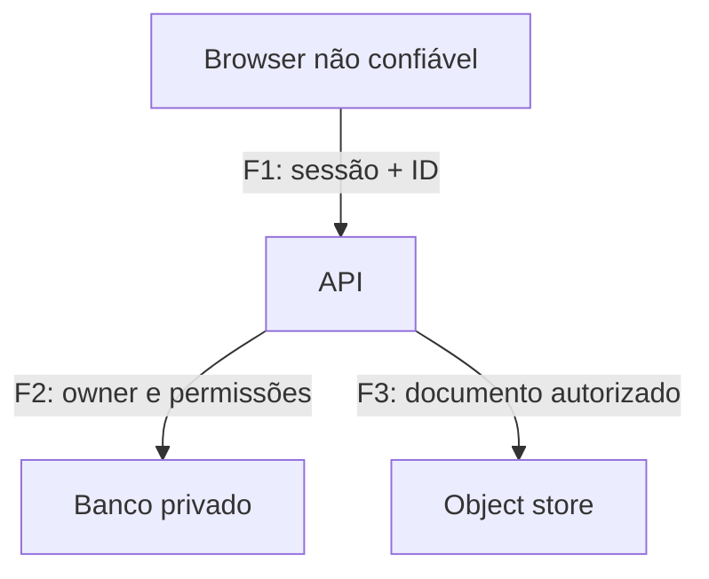

# Aula 036 — Threat Modeling com STRIDE

**Profundidade:** normal · **Tempo:** 45–60 min.  
**Pré-requisitos recomendados:** HTTP, autenticação/autorização e fundamentos de risco; não bloqueiam acesso.  
**Escopo:** modelagem de portal fictício e testes em aplicação própria.

## Problema e objetivo

O time quer lançar download de relatórios. “Usar HTTPS” foi a única decisão de segurança. HTTPS ajuda, mas não impede Bob de pedir documento de Alice nem uma credencial de leitura de apagar arquivos. Antes de escolher controles precisamos modelar componentes, dados, identidades e fronteiras.

Ao final você terá um modelo pequeno e seis ameaças justificadas por fluxos, com controles e testes. STRIDE é uma lista de perguntas para encontrar classes de ameaça; não é score de risco, prova de vulnerabilidade ou exigência de preencher seis ameaças em toda caixa.

## Modelo concreto

Em F1, dados atravessam de cliente controlável para serviço. Em F2/F3, a API usa autoridade que o cliente não deve herdar automaticamente. Identifique os dados armazenados, quem escreve e qual identidade executa cada ação. Uma seta “API→banco” sem operação/principal oculta justamente a decisão relevante.

O modelo completo está em `public/course-labs/phase16-web-p0/stride-model.json`: quatro entidades, três fluxos e seis ameaças com testes.

## As seis perguntas, com mecanismo

| Categoria | Pergunta concreta | Exemplo neste portal |
|---|---|---|
| Spoofing | Posso me apresentar como outra identidade? | API confia em user=Alice enviado pelo browser |
| Tampering | Posso alterar dado/estado sem autorização? | Update aceita owner definido pelo cliente |
| Repudiation | Uma ação relevante fica sem atribuição verificável? | Alteração sem ator, objeto e horário em log protegido |
| Information Disclosure | Informação chega a quem não deve? | Link privado servido por cache público |
| Denial of Service | Recurso finito pode ser esgotado? | Consulta sem limite ocupa todas as conexões |
| Elevation of Privilege | Uma entidade obtém ação além do privilégio previsto? | Identidade de leitura também pode apagar objetos |

Categorias podem se sobrepor: mudar owner pode resultar em divulgação e elevação. Escolha a descrição que melhor expressa a condição, explique o vínculo e não conte duplicações como novos riscos independentes.

## Exemplo resolvido: identidade de serviço excessiva

**Ativo:** relatório privado no storage. **Fluxo:** F3. **Pré-condição:** API usa a mesma credencial para ler e apagar. **Ameaça T6:** falha em uma rota pode executar Delete usando uma autoridade que a função download nunca precisou.

A causa é a permissão excessiva da identidade, não o nome da biblioteca. Controle: separar identidade de leitura, negar exclusão e não expor operação genérica de storage ao cliente. Teste positivo de uso legítimo: Get do documento autorizado funciona. Teste de restrição: Delete com a mesma identidade é negado. Evidência: operação, principal, recurso e decisão de autorização; não é necessário apagar um arquivo real para provar a política.

**Autoexplicação:** por que um WAF não substitui a identidade de leitura? O WAF filtra requisições; a policy limita a autoridade efetiva no storage mesmo quando uma requisição atravessa a camada web.

## Exercício parcialmente resolvido

T4: `/report/10.css` produz um documento privado, mas o cache guarda todo caminho `.css`. O fluxo é F3 seguido da resposta da API ao browser. Complete pré-condição, controle e dois testes.

Solução: há divergência entre semântica da rota e classificação do cache; a resposta personalizada não pode entrar em cache compartilhado. Aplicar política privada no origin e no proxy. Alice recebe o próprio conteúdo, Bob não recebe o de Alice; asset público anônimo continua cacheável. A Aula 47 desenvolve esse caso em laboratório real.

## Prática independente e checkpoints

1. Abra o JSON do modelo e esconda temporariamente os campos control/test.
2. Para T1–T6, escreva o principal, o dado controlável e o estado incorreto possível.
3. Proponha controle no componente responsável pela decisão.
4. Crie um teste que falha antes e passa depois, mantendo um caso legítimo.
5. Compare com o gabarito do JSON; divergência fundamentada pode ser aceitável.

No diretório do lab execute `node read-models.mjs`. A tabela deve listar T1–T6 e F1/F2/F3 existentes. Isso é uma verificação de consistência do documento; **não valida a segurança do sistema fictício**. Os testes de cada ameaça ainda precisam ser implementados nos labs correspondentes.

Checkpoint 1: cada ameaça possui condição e consequência, não somente “SQLi” ou “malware”? Checkpoint 2: o teste avalia a decisão do controle? Checkpoint 3: a ameaça residual permanece explicitada, por exemplo vazamento por conta legitimamente comprometida?

## Detecção, correção e revisão do modelo

T1 requer eventos de validação de sessão; T2, trilha de alterações; T3, proteção e correlação dos logs; T4, evidência de resposta/cache; T5, latência e uso do pool; T6, decisão IAM. Não existe uma query única que valide todas as categorias.

Revisite o modelo quando mudar identidade, fluxo, armazenamento ou operação exposta. Um novo worker que lê arquivos pode criar outra fronteira mesmo sem nova tela. Depois da correção, repita o teste da ameaça, documente o resultado e atualize o risco residual.

Troubleshooting: se todas as ameaças parecem iguais, suas setas provavelmente não têm dados e operações definidos. Se o controle é sempre “validar entrada”, procure autorização, integridade do estado e limites de recursos. Se o diagrama ficou enorme, decomponha por caso de uso mantendo as fronteiras compartilhadas.

## Desafio final

Acrescente upload ao portal: browser→API recebe bytes e API→storage grava objeto. Identifique duas ameaças distintas e critérios de aceite. Referência: Tampering em nome/metadata alterando destino; DoS por tamanho/quantidade. Rejeitar destino fora do namespace e tamanho excedido, preservando upload PNG pequeno legítimo. Não basta acrescentar duas etiquetas STRIDE ao desenho.

## Quiz

1. STRIDE serve principalmente para: A) substituir testes. B) estimar automaticamente CVSS. C) orientar perguntas sobre classes de ameaça. **Resposta: C.** O modelo orienta investigação; evidência e priorização vêm depois.
2. Qual registro é mais útil? A) “T6: credencial de leitura pode Delete; testar policy com esse principal”. B) “Risco alto: cloud”. C) “Adicionar firewall”. **Resposta: A.** Há condição, autoridade e teste verificável.
3. Um log sem identidade protege bem contra repúdio? A) Sim, basta horário. B) Não; atribuição e integridade do registro precisam ser consideradas. C) Sim, se estiver em JSON. **Resposta: B.** Formato não resolve autenticidade e contexto.
4. Quando revisar o modelo? A) Só depois de incidente. B) Apenas quando mudar CSS. C) Quando mudar fluxo, identidade, dado ou fronteira relevante. **Resposta: C.** Mudanças de autoridade alteram as hipóteses.

## Flashcards

- **Fronteira de confiança?** Ponto em que dados ou autoridade passam entre contextos com diferentes garantias.
- **Ameaça bem formulada?** Condição + ação possível + ativo/efeito, ligados a um fluxo ou componente.
- **STRIDE fornece prioridade?** Não automaticamente; impacto, exposição e controles contextualizam o risco.
- **Controle para T6?** Menor privilégio na identidade de storage, testado por operação/recurso.
- **Diagrama validado significa sistema seguro?** Não: consistência do modelo e eficácia do controle são evidências diferentes.

## Referência

[Microsoft — Threat modeling](https://learn.microsoft.com/en-us/azure/security/develop/threat-modeling-tool-threats). Use o modelo como instrumento de raciocínio, com exemplos próprios e escopo documentado.
